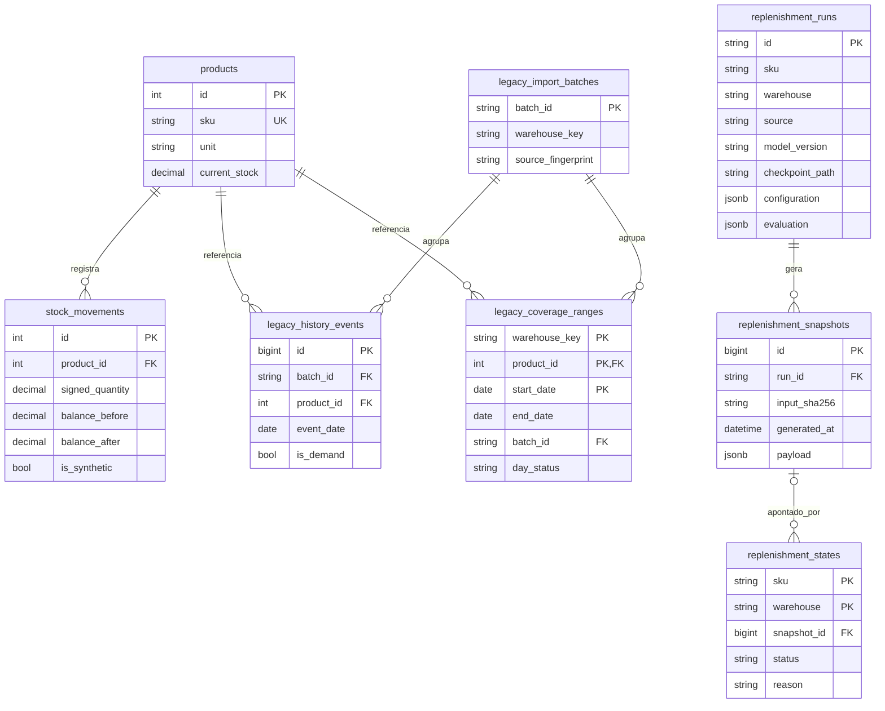

# IA de reposição e banco de dados

O EstoqueFácil usa uma **Deep Q-Network (DQN)** para escolher quantas unidades pedir para um SKU. O worker roda em CPU, grava a sugestão no PostgreSQL e a API a apresenta em **Relatórios → Reposição**. O processo termina na recomendação. A movimentação de estoque e a decisão de compra seguem o fluxo operacional do sistema.

## 1. O problema de aprendizado

O [simulador](../backend/app/ai/simulator.py) avança um dia por vez e representa um item, com vendas perdidas quando o saldo é insuficiente.

| Elemento | Implementação |
| --- | --- |
| Estado observado | Saldo disponível na hora da decisão e unidades a receber em cada um dos próximos $L_{\max}$ dias. A rede divide essas quantidades pelo limite de pedido. |
| Ação | Quantidade inteira entre zero e o limite configurado, inclusive. Na configuração sintética, o limite é 20 e a fila tem cinco posições. |
| Transição | Os recebimentos do dia entram antes da decisão. O pedido é agendado para o prazo daquele dia. O simulador revela a demanda, atende até o limite do saldo e registra o restante como venda perdida. |
| Custo | Armazenagem sobre o saldo final, custo fixo nos dias com pedido, custo variável por unidade pedida e custo por unidade perdida. No fim do horizonte, pedidos pendentes e saldo remanescente têm valor residual zero. |
| Recompensa | Custo diário com sinal negativo, dividido pela escala de recompensa quando configurada. A escala altera o treino. As métricas continuam usando o custo original. |

No cenário sintético, a entrada tem seis valores. O [DQN](../backend/app/ai/dqn.py) usa duas camadas densas de 32 neurônios com ReLU e retorna 21 valores Q, um por ação. Durante a inferência, a ação é o índice do maior Q. Na calibração, o tamanho da fila da rede acompanha o prazo escolhido para o SKU.

O treino usa exploração $\epsilon$-greedy, memória de replay, lotes de 64 transições, Adam com taxa de 0,001 e perda Smooth L1. A rede-alvo é sincronizada a cada 100 atualizações do otimizador. O desconto é $\gamma=0{,}97$. Para cada transição, o alvo é $r$ no dia terminal e $r + \gamma \max_{a'} Q_{\mathrm{alvo}}(s', a')$ nos demais dias. O checkpoint local contém pesos, versão do modelo, parâmetros e identificadores dos episódios de treino.

## 2. De onde vêm os dados

| Modo do worker | Evidência usada | Condições para publicar |
| --- | --- | --- |
| `synthetic` | Trajetórias simuladas de demanda e prazo. | SKU ativo em `UN` com saldo inteiro não negativo. A fila pode ser simulada. A interface exibe **Simulação acadêmica**. |
| `legacy_calibrated` | Eventos e séries de cobertura importados do Firebird para o PostgreSQL. | Série com disponibilidade verificada, 56 dias elegíveis consecutivos, prazo disponível, saldo operacional rastreável e fila informada. |
| `operational_calibrated` | Livro de movimentações registrado pelo próprio sistema, no depósito `1`. | Entrada de saldo inicial real a partir de zero, reconciliação com o saldo atual, 56 dias completos consecutivos com disponibilidade comprovada e fila atual informada. Exige `--once`. |

Nos modos calibrados, a janela é dividida em **28 dias para calibração, 14 para validação e 14 para teste**. O worker ajusta a média do gerador de demanda aos primeiros 28 dias e treina sobre episódios simulados. Validação e teste reproduzem suas janelas cronológicas com o prazo definido na calibração. A avaliação operacional histórica começa com fila simulada vazia. Para inferência calibrada, o worker recebe a fila atual explicitamente.

Venda registrada prova atendimento naquele momento. Para tratar zero vendas como zero demanda observada, é preciso evidência de disponibilidade. Dias com ruptura, evidência insuficiente ou ajustes que invalidam a reconstrução podem impedir a calibração. O recorte real de Firebird da [entrega integrada](LOCAL_DELIVERY.md#calibração-legada) retornou `insufficient_data`. O caminho de publicação calibrada foi exercitado com dados de teste.

O fluxo está implementado em [calibração legada](../backend/app/ai/calibration.py), [calibração operacional](../backend/app/ai/operational_calibration.py) e [worker](../backend/app/ai/replenishment_worker.py).

## 3. Como o PostgreSQL participa

O PostgreSQL 16 guarda o estoque operacional, a cobertura histórica e as saídas da IA. O Firebird fornece histórico ao importador, que faz a reconciliação por lote. O worker consulta os dados preparados no PostgreSQL. Os pesos ficam em arquivo local `.pt`, com o caminho registrado na execução.

### Modelo relacional do fluxo

O diagrama mostra as tabelas centrais do fluxo e as chaves estrangeiras selecionadas. A IA localiza o produto por SKU e agrupa resultados por `(sku, warehouse)`. Esse vínculo com o catálogo é lógico. As tabelas de execução e de estado não possuem chave estrangeira para `products`.



- **Execução.** `replenishment_runs` guarda a origem, a versão, a configuração e o resultado da avaliação. O worker pode reutilizar o checkpoint quando a configuração coincide e o arquivo está disponível.
- **Sugestão.** `replenishment_snapshots` guarda a quantidade e sua proveniência como JSONB. A assinatura das entradas permite identificar o mesmo conjunto de saldo, fila e data de referência.
- **Estado atual.** `replenishment_states` guarda o estado por SKU e depósito e aponta para a última recomendação publicada, quando houver. O [serviço de leitura](../backend/app/services/replenishment_reports.py) sinaliza uma recomendação armazenada como desatualizada quando o estado deixa de estar pronto, a sugestão passa de 24 horas ou o cadastro do produto foi atualizado após a publicação.

O [worker](../backend/app/ai/replenishment_worker.py) usa um bloqueio consultivo do PostgreSQL para serializar suas execuções. Ao concluir o cálculo, a [publicação](../backend/app/ai/publication.py) grava execução, snapshot e ponteiro de estado na mesma transação. A API consulta o resultado persistido em `GET /api/reports/replenishment` e as métricas em `GET /api/reports/comparison`. Veja os [modelos SQLAlchemy](../backend/app/models/replenishment.py), a [migração legada](../backend/alembic/versions/0002_legacy_staging.py), a [migração integrada](../backend/alembic/versions/0004_integrated_operational.py) e o [contrato HTTP](contracts/report-v1/README.md).

### Mostrar uma recomendação no banco

Depois de executar o [roteiro local da demonstração](LOCAL_DELIVERY.md#reprodução-local), use a seguinte consulta no PostgreSQL de demonstração. Ela percorre o estado, o snapshot e a execução para o SKU sintético.

```sql
SELECT
    state.sku,
    state.status,
    run.source,
    run.model_version,
    run.id AS model_run_id,
    snapshot.payload ->> 'recommended_quantity' AS quantity,
    snapshot.payload ->> 'unit' AS unit,
    snapshot.generated_at
FROM replenishment_states AS state
LEFT JOIN replenishment_snapshots AS snapshot ON snapshot.id = state.snapshot_id
LEFT JOIN replenishment_runs AS run ON run.id = snapshot.run_id
WHERE state.sku = 'DEMO-MOUSE-01' AND state.warehouse = '1';
```

A quantidade, a unidade e a origem são os mesmos campos que alimentam o relatório. O banco de demonstração pode ser recriado pelas migrações do Alembic.

## 4. Avaliação do modelo

Os [cenários](../backend/app/ai/scenarios.py) têm 60 dias e cobrem demanda regular, pico de demanda e prazo longo. O gerador usa sementes separadas para **180 episódios de treino**, **18 de validação** e **18 de teste**. As [políticas de referência](../backend/app/ai/baselines.py) são ajustadas na validação. O **base-stock** repõe até uma posição-alvo. A política **(s, S)** só repõe até `S` quando a posição de estoque fica no limiar `s` ou abaixo. A posição de estoque é o saldo mais os pedidos a receber. O [avaliador](../backend/app/ai/evaluation.py) executa as três políticas sobre as mesmas demandas e prazos no teste.

As métricas por episódio são custo acumulado, fill rate (unidades atendidas ÷ demanda total), dias com demanda perdida, saldo final médio e dias com pedido. O teste sintético documentado na [entrega local](LOCAL_DELIVERY.md#verificação-integrada) registrou custo total de 16.564 para o DQN inicial, 12.525 para base-stock e 12.498 para (s, S), na soma dos 18 episódios. O experimento de ajuste com oito passagens e decaimento por passo (cinco sementes de treino, 42 a 46) chegou a **12.768,60 de custo total médio** e **79,72% de fill rate médio** nos mesmos 18 episódios de teste. Esses números medem desempenho no simulador. O custo médio ajustado ficou acima das duas referências.

### Reproduzir o experimento sintético

Execute os comandos na raiz do repositório com o ambiente Python do backend ativo.

```sh
python -m pip install -r backend/requirements-dqn.txt
PYTHONPATH=backend python -m app.ai.dqn .local/dqn-seed42.pt \
  --seed 42 --passes 8 --epsilon-by-step --epsilon-decay-fraction 0.40
PYTHONPATH=backend python -m app.ai.evaluation \
  .local/dqn-seed42.pt .local/avaliacao-seed42.json \
  --revision "$(git rev-parse HEAD)"
```

Repita com as sementes 43 a 46 e arquivos distintos para comparar a variação do treinamento. O experimento registrado usou PyTorch 2.15.0 e NumPy 2.5.5. Cada JSON guarda as partições, os resultados por política e episódio e o passo a passo do primeiro episódio. O worker sintético padrão chama `train_demo` com uma passagem. O [documento da v1](AI_INTEGRATION_AND_EVALUATION.md) descreve as exportações analíticas e o caminho de previsão por média móvel desenvolvido anteriormente.
